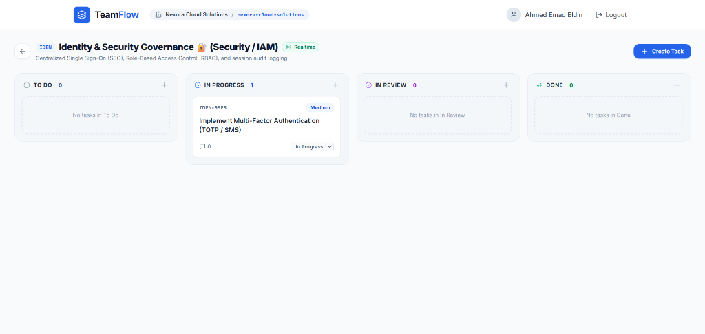
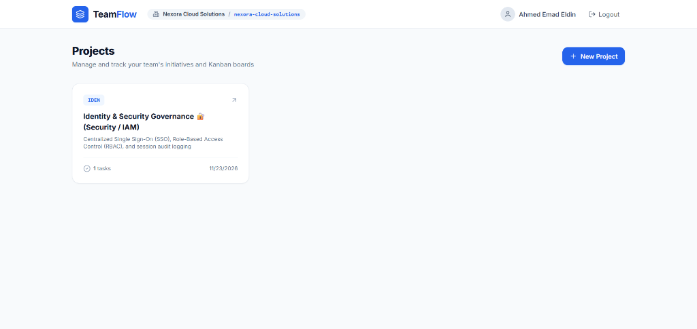
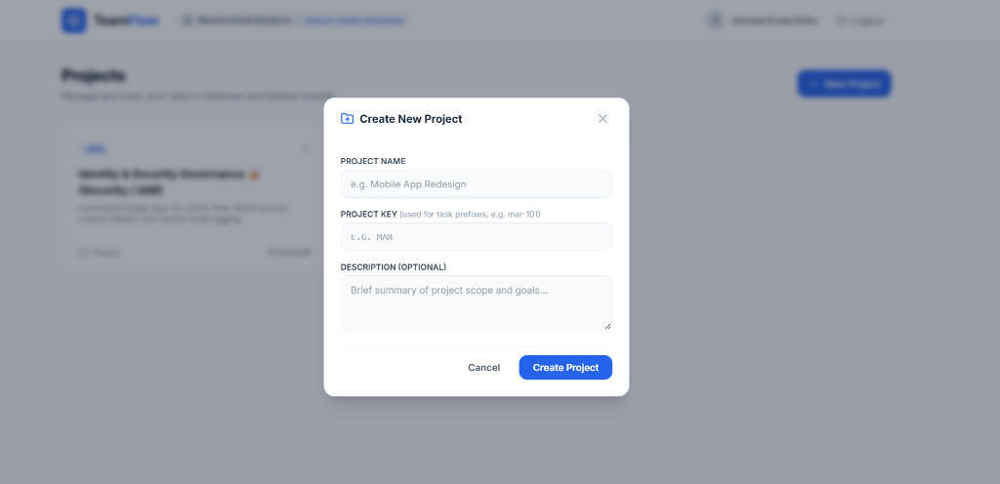
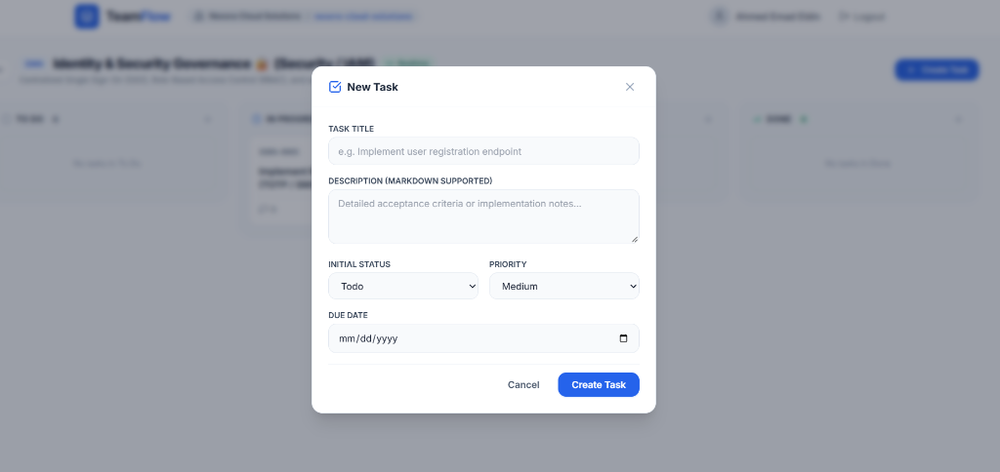
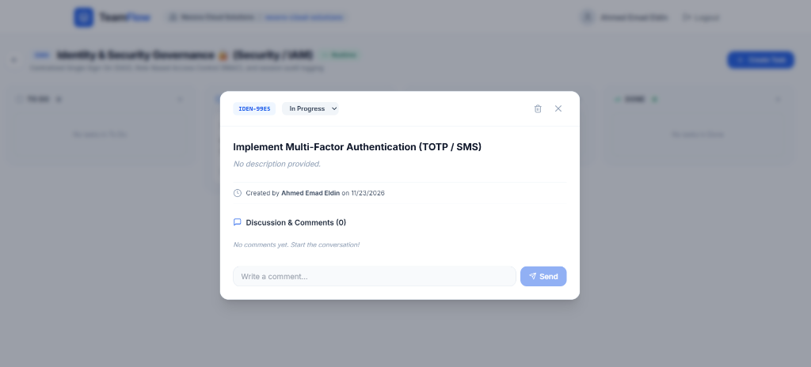
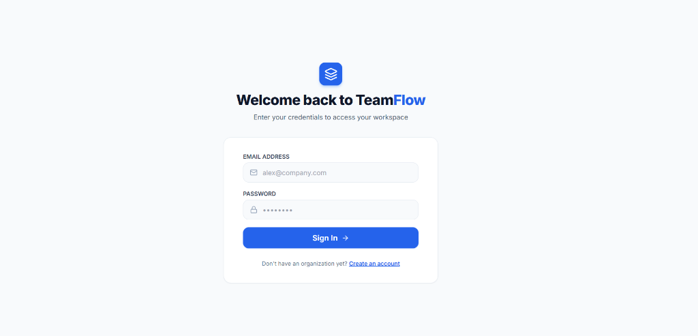
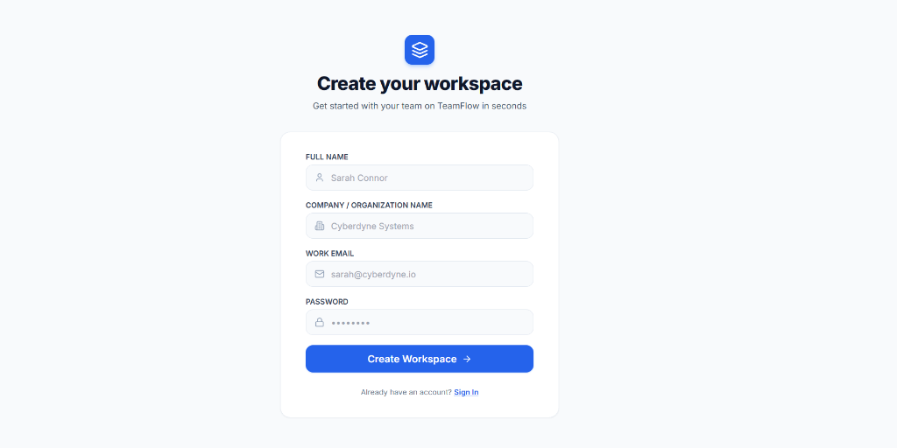

# 🚀 TeamFlow — Enterprise Project Management SaaS & Distributed Platform

[](https://dotnet.microsoft.com/)
[](https://react.dev/)
[](https://www.typescriptlang.org/)
[](https://www.postgresql.org/)
[](https://redis.io/)
[](https://www.rabbitmq.com/)
[](https://www.docker.com/)
[](LICENSE)

**TeamFlow** is a production-grade, enterprise-ready Project Management SaaS platform designed to manage workspaces, projects, teams, and collaborative Kanban boards in real-time. Built from the ground up with **Clean Architecture**, **SOLID principles**, and **Domain-Driven Design (DDD)**.

---

## 📸 Screenshots & Application Preview

<div align="center">

### 🎯 Real-Time Collaborative Kanban Board
*Live updates across active collaborators via SignalR WebSockets, task lifecycle status updates, and optimistic UI transitions.*



</div>

<br/>

| 📂 Multi-Tenant Project Dashboard | ➕ Create New Project Modal |
| :---: | :---: |
|  |  |

| 📝 Task Creation Modal | 💬 Task Details & Discussion Thread |
| :---: | :---: |
|  |  |

| 🔐 Enterprise Authentication (Sign In) | 🏢 Multi-Tenant Workspace Registration |
| :---: | :---: |
|  |  |

---

## 🏛️ System Architecture

```
                                 [ React + TS Client ]
                                          │
                                    Port 5000 (HTTP)
                                          ▼
                         ┌───────────────────────────────────┐
                         │      YARP API Gateway             │
                         │   (Rate Limiting & Reverse Proxy) │
                         └───────┬───────────────────┬───────┘
                                 │                   │
                  /api/* & /hubs │                   │ /api/notifications/*
                                 ▼                   ▼
     ┌───────────────────────────────┐     ┌───────────────────────────────┐
     │      TeamFlow.CoreAPI         │     │     TeamFlow.Notifications    │
     │      (Port 5100)              │     │     (Port 5050 Microservice)  │
     └───────────────┬───────────────┘     └───────────────▲───────────────┘
                     │                                     │
           Same DB   │ (Transactional                      │ Subscribes to
         Transaction │  Outbox Pattern)                    │ 'event.#'
                     ▼                                     │
           [ PostgreSQL DB ]                               │
         (Table: OutboxMessages)                           │
                     │                                     │
        OutboxWorker │ Polls &                             │
         Background  │ Publishes                           │
                     ▼                                     │
        ════════════════════════════════════════════════════
             RabbitMQ Event Bus (Topic: teamflow.events)
        ════════════════════════════════════════════════════
```

---

## ✨ Key Features & Engineering Highlights

### 🏢 1. Multi-Tenancy & Row-Level Isolation
- **Shared Database with Row-Level Isolation**: Complete tenant data isolation using EF Core **Global Query Filters** bound to `ITenantScoped`.
- **Automatic Tenant Assignment**: Tenant context is resolved from verified JWT claims (`ICurrentUserService`) and assigned during `SaveChangesAsync`.
- **Composite Unique Constraints**: Tenant-scoped uniqueness (e.g. `(OrganizationId, Key)` for project keys).

### 🔐 2. Enterprise Authentication & Security
- **JWT Authentication**: Short-lived access tokens with `ClockSkew = TimeSpan.Zero`.
- **Refresh Token Rotation & Reuse Detection**: Tokens are single-use; any reuse attempt of a compromised token triggers an emergency revocation of all active sessions for that user.
- **BCrypt Password Hashing**: Adaptive work-factor hashing with embedded salt.
- **Frontend Interceptor Queueing**: Transparent Axios interceptor queues parallel 401 requests and replays them upon successful token refresh.

### ⚡ 3. Real-Time Collaboration (SignalR)
- **Live Kanban Board**: Real-time status updates and card movements across users.
- **Hub Project Groups**: Scoped broadcasting (`project_{id}`) ensures events are only delivered to active collaborators on the same board.
- **Optimistic UI Updates**: Immediate client-side drag-and-drop with server-side rollback on error.

### 🚀 4. Distributed Caching (Redis)
- **Cache-Aside Pattern**: Tenant-isolated keys (`tenant_{orgId}_projects`) for project listing.
- **Instant Eviction**: Cache is evicted on mutations (`CreateProjectAsync`).
- **Graceful Degradation**: If Redis is unreachable, the system transparently falls back to PostgreSQL without interrupting user experience.

### 📨 5. Event-Driven Architecture & Transactional Outbox Pattern
- **Dual-Write Mitigation**: Solves distributed inconsistency between PostgreSQL and RabbitMQ by recording domain events (`TaskCreatedEvent`, `TaskStatusUpdatedEvent`) into `OutboxMessages` within the same DB transaction.
- **Asynchronous Outbox Processor**: Background worker reliably polls unprocessed events and dispatches them to **RabbitMQ** (Topic Exchange: `teamflow.events`).
- **Notification Microservice**: Independent service consuming from RabbitMQ queue `notifications.task-events` with manual acknowledgments (`BasicAck`).

### 🛡️ 6. API Gateway & Centralized Control
- **YARP (Yet Another Reverse Proxy)**: Single unified entry point routing traffic to Core API and Microservices.
- **Centralized Rate Limiting**: Fixed window limiter (200 requests/minute per client) to prevent DDoS attacks.
- **Enterprise Health Probes**: Kubernetes-ready liveness (`/health/live`) and readiness (`/health/ready`) checks.

---

## 🛠️ Tech Stack

- **Backend Framework:** ASP.NET Core Web API (.NET 10)
- **Architecture:** Clean Architecture + SOLID + Domain-Driven Design
- **Database:** PostgreSQL 16 with Entity Framework Core 10 (Npgsql)
- **Real-Time:** Microsoft SignalR (WebSockets)
- **Distributed Cache:** Redis 7 (StackExchange.Redis)
- **Message Broker:** RabbitMQ 3 (Topic Exchanges & AMQP 0-9-1)
- **API Gateway:** YARP (Yet Another Reverse Proxy)
- **Frontend:** React 18, TypeScript, Vite, Tailwind CSS, Lucide Icons, Axios
- **Testing:** xUnit, EF Core InMemory, Fluent Assertions (13 Automated Unit Tests)
- **DevOps & Containers:** Docker, Docker Compose, Multi-stage Dockerfiles, GitHub Actions CI/CD

---

## 📦 Project Structure

```
TeamFlow/
├── client/                               # React + TypeScript Frontend (Vite, TailwindCSS)
├── src/
│   ├── TeamFlow.Domain/                  # Core Business Entities, Enums, Domain Events
│   ├── TeamFlow.Application/             # Features, DTOs, Services, Interfaces, Result Pattern
│   ├── TeamFlow.Infrastructure/          # EF Core DbContext, Redis Cache, RabbitMQ, Outbox Worker
│   ├── TeamFlow.API/                     # Core REST API Controllers & SignalR Hub
│   ├── TeamFlow.Gateway/                 # YARP API Gateway & Central Rate Limiting
│   └── TeamFlow.Notifications/           # Event-Driven Notification Microservice
├── tests/
│   └── TeamFlow.UnitTests/               # xUnit Automated Unit Tests (13/13 Passing)
├── .github/workflows/ci.yml              # Automated GitHub Actions CI/CD Pipeline
├── docker-compose.yml                    # Full-Stack Multi-Container Orchestration
└── TeamFlow.slnx                         # Solution File
```

---

## 🚀 Getting Started

### Prerequisites
- [.NET 10 SDK](https://dotnet.microsoft.com/download)
- [Node.js 20+](https://nodejs.org/)
- [Docker Desktop](https://www.docker.com/products/docker-desktop/)

---

### Option 1: Quick Local Development (Recommended)

1. **Start Infrastructure (PostgreSQL, Redis, RabbitMQ):**
   ```bash
   docker compose up -d postgres redis rabbitmq
   ```

2. **Run the Backend API:**
   ```bash
   dotnet run --project src/TeamFlow.API
   ```
   > API runs on `http://localhost:5100` (auto-applies EF migrations on startup).

3. **Run the Frontend (React + Vite):**
   ```bash
   cd client
   npm install
   npm run dev
   ```
   > Frontend available at `http://localhost:5173`.

---

### Option 2: Full-Stack Docker Compose (Production Setup)

Spin up the entire distributed system (Databases, Gateway, Core API, Microservices, and Nginx Web App) with a single command:

```bash
docker compose up --build -d
```

- **Web Application:** `http://localhost:3000`
- **YARP Gateway:** `http://localhost:5000`
- **RabbitMQ Management Dashboard:** `http://localhost:15672` (User: `guest` / Pass: `guest`)

---

## 🧪 Running Automated Tests

```bash
dotnet test
```

```
Test run for .../TeamFlow.UnitTests.dll (.NETCoreApp,Version=v10.0)
Passed!  - Failed: 0, Passed: 13, Skipped: 0, Total: 13, Duration: 2 s
```

---

## 📄 License
This project is licensed under the MIT License - see the [LICENSE](LICENSE) file for details.
